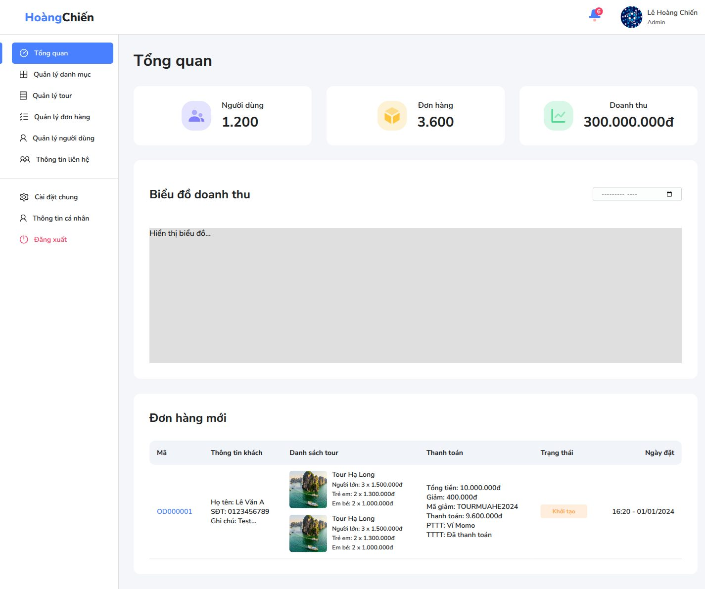
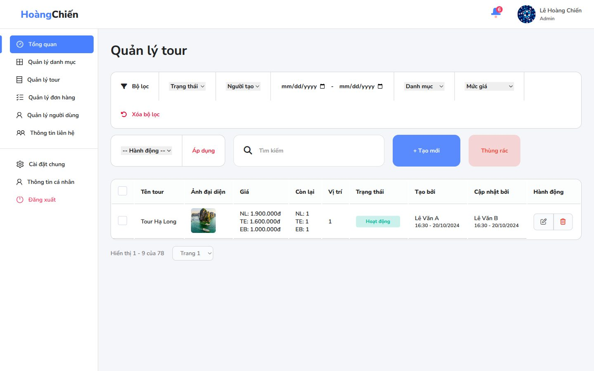
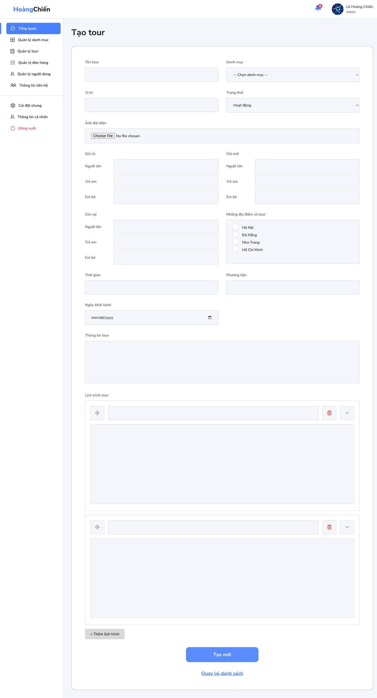
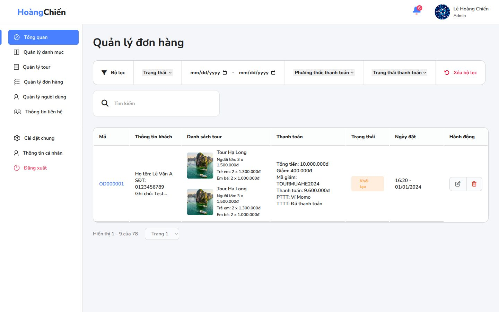
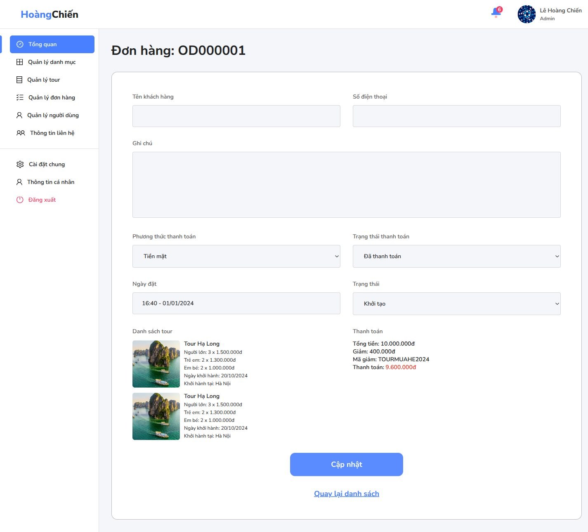
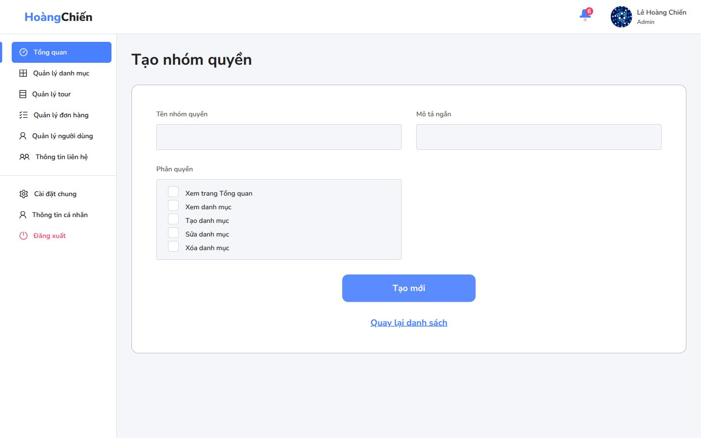
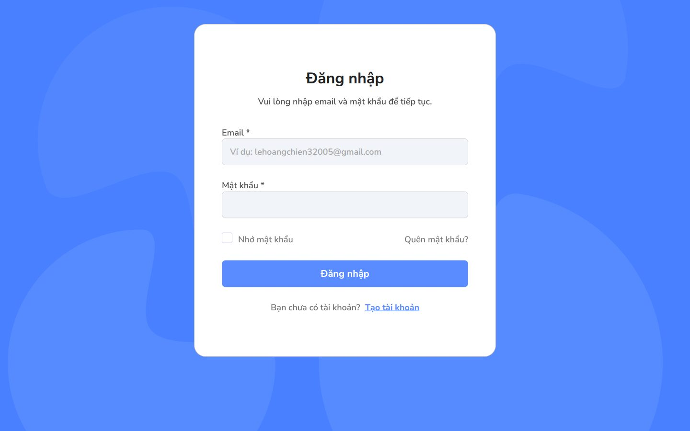
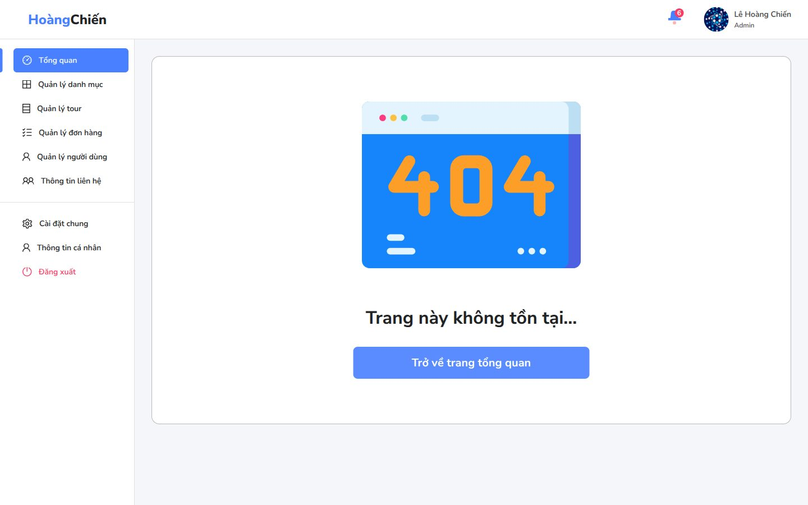
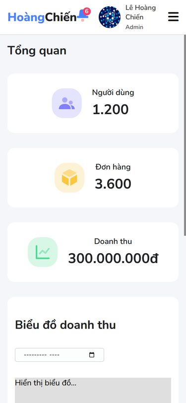
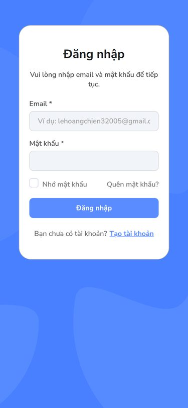

# Travel Tour Admin – Trang Quản Trị Website Đặt Tour

Giao diện trang quản trị (admin dashboard) cho website đặt tour du lịch [28.TRAVEL](https://github.com/LEHOANGCHIEN/travel-tour-website). Dự án được cắt từ thiết kế Figma, viết bằng **Pug** (template engine) và **CSS thuần**, rồi biên dịch ra HTML tĩnh.

🔗 **Demo:** https://travel-tour-admin.onrender.com/ *(host miễn phí trên Render, lần đầu truy cập có thể mất vài giây để khởi động)*
📁 **Source code:** https://github.com/LEHOANGCHIEN/travel-tour-admin
🌐 **Website khách hàng (dự án đi kèm):** https://github.com/LEHOANGCHIEN/travel-tour-website

---

## Mục lục

- [Tổng quan](#tổng-quan)
- [Ảnh chụp giao diện](#ảnh-chụp-giao-diện)
- [Công nghệ sử dụng](#công-nghệ-sử-dụng)
- [Các trang đã thực hiện](#các-trang-đã-thực-hiện)
- [Điểm nổi bật](#điểm-nổi-bật)
- [Cấu trúc thư mục](#cấu-trúc-thư-mục)
- [Chạy dự án](#chạy-dự-án)
- [Hướng phát triển](#hướng-phát-triển)
- [Tác giả](#tác-giả)

## Tổng quan

Đây là phần quản trị của hệ thống đặt tour. Quản trị viên có thể xem thống kê tổng quan, quản lý danh mục, tour, đơn hàng, người dùng, thông tin liên hệ, cài đặt website và phân quyền tài khoản quản trị.

Dự án gồm **24 trang**, dùng chung một bộ layout, header và sidebar nhờ cơ chế `extends` / `include` / `mixin` của Pug.

## Ảnh chụp giao diện

**Tổng quan (Dashboard)**



<details>
<summary><b>Quản lý tour</b></summary>
<br>

</details>

<details>
<summary><b>Tạo / chỉnh sửa tour</b></summary>
<br>

</details>

<details>
<summary><b>Quản lý đơn hàng</b></summary>
<br>

</details>

<details>
<summary><b>Chi tiết / chỉnh sửa đơn hàng</b></summary>
<br>

</details>

<details>
<summary><b>Tạo nhóm quyền</b></summary>
<br>

</details>

<details>
<summary><b>Đăng nhập</b></summary>
<br>

</details>

<details>
<summary><b>Trang 404</b></summary>
<br>

</details>

<details>
<summary><b>Giao diện mobile</b></summary>
<br>

&nbsp;

</details>

## Công nghệ sử dụng

| Công nghệ | Mục đích |
|---|---|
| **Pug** (`pug-cli`) | Template engine: layout, partial, mixin; biên dịch ra HTML |
| **HTML5** | Kết quả biên dịch, triển khai dạng trang tĩnh |
| **CSS3** | Flexbox, CSS Grid, CSS Variables, Media Queries |
| **Google Fonts** | Font *Nunito Sans* |
| **Font Awesome 6** | Bộ icon |
| **Figma** | Đọc thiết kế, lấy kích thước, màu sắc và asset |
| **Render** | Triển khai bản demo |

## Các trang đã thực hiện

| Nhóm | Trang | File Pug |
|---|---|---|
| **Tài khoản** | Đăng nhập, Đăng ký, Quên mật khẩu, Nhập mã OTP, Đặt lại mật khẩu | `login`, `register`, `forgot-password`, `otp-password`, `reset-password` |
| **Tổng quan** | Thống kê người dùng / đơn hàng / doanh thu, biểu đồ doanh thu, đơn hàng mới | `dashboard` |
| **Danh mục** | Danh sách, Tạo / chỉnh sửa danh mục | `category-list`, `category-create` |
| **Tour** | Danh sách (lọc, tìm kiếm, hành động hàng loạt), Tạo / chỉnh sửa tour (giá theo đối tượng, lịch trình nhiều ngày), Thùng rác | `tour-list`, `tour-create`, `tour-trash` |
| **Đơn hàng** | Danh sách đơn hàng, Chi tiết / chỉnh sửa đơn hàng | `order-list`, `order-edit` |
| **Người dùng & Liên hệ** | Quản lý người dùng, Thông tin liên hệ | `user-list`, `contact-list` |
| **Cài đặt chung** | Trang cài đặt, Thông tin website, Tài khoản quản trị (danh sách / tạo), Nhóm quyền (danh sách / tạo) | `setting-list`, `setting-website-info`, `setting-account-admin-list`, `setting-account-admin-create`, `setting-role-list`, `setting-role-create` |
| **Cá nhân** | Thông tin cá nhân, Đổi mật khẩu | `profile-edit`, `profile-change-password` |
| **Khác** | Trang 404 Not Found | `error-404` |

## Điểm nổi bật

- **Tái sử dụng code bằng Pug**:
  - 2 layout: `default.pug` (header + sidebar + nội dung) cho các trang quản trị và `account.pug` cho các trang đăng nhập / đăng ký.
  - Partial `header.pug`, `sider.pug` viết một lần, dùng cho mọi trang.
  - Mixin `checkbox-30` tạo checkbox tuỳ biến bằng SVG, dùng lại trong bảng, form tạo tour và form đăng nhập.
- **Giao diện quản trị đầy đủ**: bảng dữ liệu có checkbox chọn nhiều dòng, bộ lọc nhiều tiêu chí, tìm kiếm, hành động hàng loạt, phân trang, tag trạng thái màu (Hoạt động / Tạm dừng, Khởi tạo / Đã duyệt / Đã huỷ).
- **Form phức tạp**: form tạo tour có giá theo từng đối tượng (người lớn / trẻ em / em bé), chọn nhiều địa điểm khởi hành, khối lịch trình nhiều ngày có sẵn giao diện cho các nút thêm, xoá, kéo thả và thu gọn.
- **Responsive** với 4 breakpoint (1200px, 992px, 768px, 576px); trên màn hình nhỏ, sidebar được ẩn và thay bằng nút menu.
- **CSS Variables** cho màu chủ đạo (`--color-main: #4880FF`) và màu chữ.
- Header và sidebar cố định, chỉ vùng nội dung cuộn, giống các trang quản trị thực tế.

## Cấu trúc thư mục

```
travel-tour-admin/
├── views/                      # Mã nguồn Pug
│   ├── layouts/
│   │   ├── default.pug         # Layout trang quản trị (header + sidebar)
│   │   └── account.pug         # Layout trang đăng nhập / đăng ký
│   ├── partials/
│   │   ├── header.pug
│   │   └── sider.pug
│   ├── mixins/
│   │   └── checkbox.pug        # Mixin checkbox tuỳ biến
│   └── pages/                  # 24 trang, mỗi trang một file
├── *.html                      # HTML được biên dịch từ views/pages
├── assets/
│   ├── css/style.css           # Toàn bộ style, chia theo section
│   └── images/                 # Icon, avatar, ảnh minh hoạ
├── docs/screenshots/           # Ảnh chụp giao diện dùng trong README
└── package.json
```

## Chạy dự án

**Xem nhanh:** mở bất kỳ file `.html` nào (ví dụ `dashboard.html`) bằng trình duyệt, không cần cài đặt.

**Chỉnh sửa giao diện:** cần [Node.js](https://nodejs.org/) và Yarn (hoặc npm).

```bash
git clone https://github.com/LEHOANGCHIEN/travel-tour-admin.git
cd travel-tour-admin
yarn install
yarn start
```

Lệnh `yarn start` chạy `pug -w ./views/pages -o ./ -P`: theo dõi thư mục `views/pages` và tự biên dịch lại ra file `.html` ở thư mục gốc mỗi khi lưu file `.pug`.

## Hướng phát triển

- [ ] Nối các link trong sidebar, nút "Tạo mới", "Quay lại danh sách" tới đúng trang và đánh dấu mục đang mở trên sidebar
- [ ] Vẽ biểu đồ doanh thu bằng Chart.js
- [ ] Thêm JavaScript: mở / đóng sidebar trên mobile, kéo thả sắp xếp lịch trình, chọn tất cả checkbox, xem trước ảnh khi upload
- [ ] Xây dựng backend (Node.js / Express + MongoDB), chuyển các trang Pug thành view render từ server, thêm xác thực và phân quyền thật

## Tác giả

**Lê Hoàng Chiến**

- GitHub: [@LEHOANGCHIEN](https://github.com/LEHOANGCHIEN)

---

> Thiết kế giao diện được tham khảo từ bản Figma của khoá học lập trình web tại 28Tech. Hình ảnh trong dự án chỉ dùng cho mục đích học tập.
